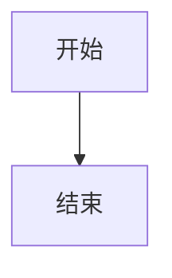
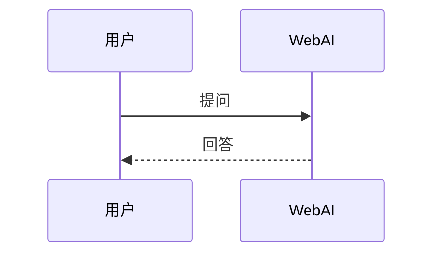

# WebAI 控制台

网页和本机 Cursor CLI 共用一条会话。工作目录就是启动包装命令时的当前目录，不需要 `bot/agent.ts`。

Windows 和 Linux 的包装命令不同。Windows 仍使用 `agent`，只监听本机，打开网页不需要密码。Linux 使用 `cursor-web`，避免和 Cursor 自带的 `agent` 冲突；服务监听所有网卡，第一次打开网页要设置密码。

Cursor 的回复默认按 Markdown 显示：标题、列表、表格、代码块，以及用 Mermaid 画的流程图、时序图、类图、状态图。页头的「图形化 / 纯文本」按钮可以在两种阅读方式之间切换，选择会留在这个浏览器里。图要放在 `mermaid` 代码块里，例如：

````text

````

````text

````

## Windows

`D:\AI_Proj\webAI\bin` 放在用户 PATH 最前面。在任意目录执行：

```text
agent
agent --continue
```

包装命令 `bin\agent.cmd` 会先确认 http://127.0.0.1:3080/ 在运行。新开会话时先 `agent create-chat`；`--continue` 或已有 `--resume` 则沿用原来的 chat id。然后打开：

```text
http://127.0.0.1:3080/?chat=<id>
```

终端里启动的是 Cursor 自带的 `agent.cmd --resume <id> --force --trust`。网页发来的消息写入同一条会话。同一条会话同时只处理一条网页消息。处理中继续发送会进入队列，当前这轮结束后按顺序执行。处理中可以按「终止」或 Esc 停掉当前这一轮。

再开一个终端执行 `agent` 会新建另一条会话，并再打开一个页面。两个页面可以同时对话。左侧列表能切到已经附着过的会话。同一个目录里的 `agent --continue` 会回到这个目录上一次启动的那条会话；如果本地还没记过，会按该目录在 Cursor 里最近的会话附着。找不到可继续的会话时，网页不会附着，终端仍按 CLI 自己的 `--continue` 启动。

也可以双击 `D:\AI_Proj\webAI\start-console.cmd`，只开网页、不启动 CLI。Windows 上的网页只监听 `127.0.0.1:3080`，不启用密码。

网页左侧「新开会话」可以直接选工作目录并开启 Agent：点「浏览」用本机文件夹对话框，或自己填路径，再点「开启 Agent」。如果这个目录已经有旧会话，页面会先提示「使用旧的」或「新建」；选旧的会附着到最近那条，选新建才会再调 Cursor CLI 的 `create-chat`。无需再开命令行。

会话列表里每条都可以点 `R` 重命名、点 `-` 从网页列表移除（不删除 Cursor 里的对话）；还没改过名的，显示这条会话第一句问题。目录标题右侧的 `+` 可以直接在该目录新建一条会话。处理中的会话和对应目录组会以蓝色标出。

输入框上方可以按会话选择**模型**与**模式**（默认 / Agent / Plan / Ask），点**代理**配置访问外网的 HTTP/HTTPS 代理（留空为直连），点 **API Key** 先在线验证再替换 Cursor API Key（全程不显示明文，也可恢复默认），最右侧 `A- / 100% / A+` 可缩放对话字体。对话往上滚到顶时可点「加载更多历史记录」往前翻到第一条；如果某一轮执行失败，页面会给出具体失败原因，并把刚才的问题放回输入框方便重试。

## Linux

Linux 不使用 `bin/agent`。包装命令是 `bin/cursor-web`，它调用本机的 `~/.local/bin/agent`（也可用环境变量 `CURSOR_AGENT_BIN` 指定），不会替换 Cursor 自带的 `agent`。

```bash
chmod +x bin/cursor-web bin/ensure-console.sh start-console.sh
ln -sfn "$(pwd)/bin/cursor-web" "$HOME/.local/bin/cursor-web"
```

`$HOME/.local/bin` 需要在 `PATH` 里。脚本会沿着符号链接找到仓库里的 `ensure-console.sh`。然后在工作目录执行：

```bash
cursor-web
cursor-web --continue
```

行为与 Windows 的 `agent` / `agent --continue` 相同：确认网页服务、创建或继续会话、再启动 Cursor CLI 的 `agent --resume <id> --force --trust`。终端会打印：

```text
http://127.0.0.1:3080/?chat=<id>
```

Linux 上的服务监听 `0.0.0.0:3080`，同一页面也可以用这台机器的局域网地址打开，例如 `http://192.168.0.33:3080/`。第一次打开时在页面上设置密码（至少 4 位）；如果是在终端前台第一次启动，会先在终端里要求设置。之后每次打开浏览器都要输入这个密码。密码以哈希写在 `console/auth.json`，权限 `600`，不提交到仓库。本机 `cursor-web` 附着会话仍走 `127.0.0.1`，不经过网页登录。

只开网页、不启动 CLI：

```bash
./start-console.sh
```

Node 先用 `WEB_AI_NODE`，再看 `.tools/node-home.txt` 里的 `bin/node`，最后用 `PATH` 里的 `node`。

本机附着过的会话记在 `console/cli-sessions.json`，不提交到仓库。

开发过程见 [HISTORY.md](./HISTORY.md)。
